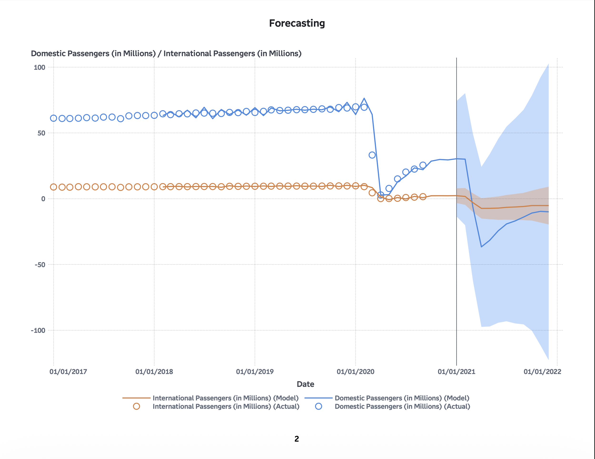
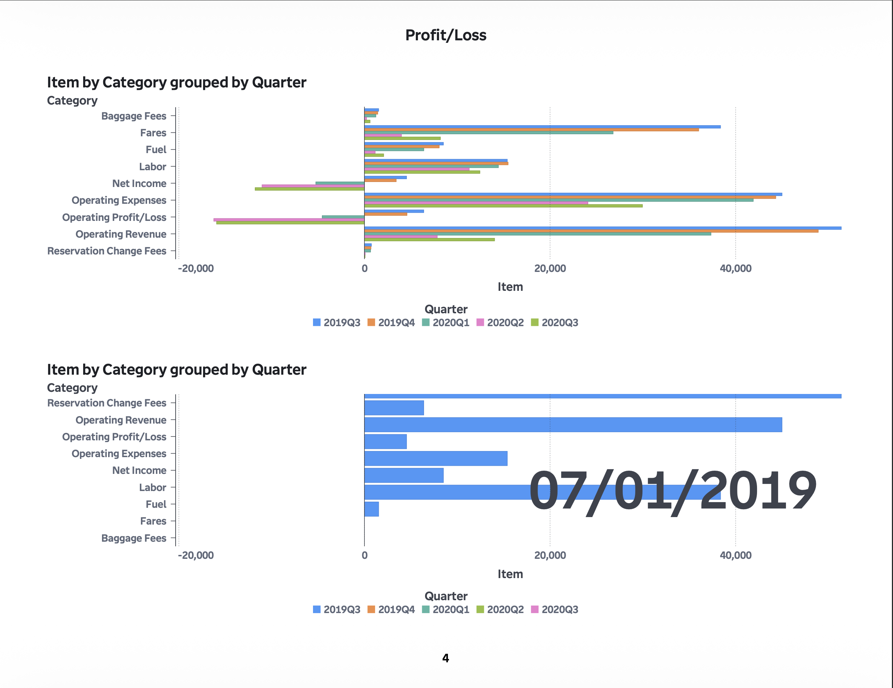
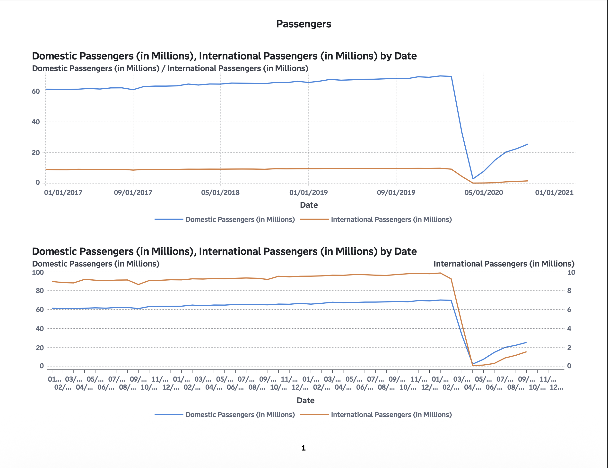

# U.S. Aviation Traffic, Employment and Financial Trends

**Author:** Cameron Batts

**Tools:** SAS Visual Analytics / SAS Viya

## Problem
Examine the 2020 disruption in passenger traffic, employment and quarterly airline finances.

## Approach
Review the SAS PDF and independently parse all five included CSV tables. Calculate matched-month passenger changes, the latest observed workforce change and Q3 2019-to-Q3 2020 revenue changes. Treat SAS dots as missing values.

## Findings
April 2020 domestic passengers were 2.86 million versus 67.06 million in April 2019, a 95.74% decline. International passengers fell from 9.57 million to 0.13 million (98.64%). Employment fell from 455,566 in December 2019 to 368,162 in October 2020 (19.19%). All Routes operating revenue declined 72.71% between Q3 2019 and Q3 2020.

## Limitations
Passenger observations end in September 2020; October through December are missing. Employment observations end in October 2020, with November and December missing. Charts extending into 2021 or 2022 include forecasts, not verified recovery observations. Airline labels such as Merica and Oceanic appear renamed; they do not support identification of real carriers. Financial scaling is not documented in the CSV headers, so percentages and source units are reported without inferring dollar magnitudes. Forecast specification, holdout accuracy and intervals cannot be validated from static exports.

## Data and provenance
Five repository CSV tables cover passenger traffic, employment, airline summaries and financials. Prior documentation attributes the material to U.S. Department of Transportation data, but no original download URL or transformation history is supplied. Carrier labels indicate an adapted teaching extract.

## Verification
All five CSV tables parsed; numerical checks executed with the included standard-library Python script. SAS forecasts and native interactions were not rerun.

## View the project
- [Analysis report](Reports/sas_us_aviation_industry_trends.html)
- [Portfolio analysis](https://cameron-batts.github.io/sas_us_aviation_industry_trends.html)
- [Original PDF export](Reports/U.S.%20Aviation%20Industry%20Trends%20using%20SAS%20Visual%20Analytics%20on%20May%2018%2C%202026.pdf)

## Dashboard previews

## Reproduce and inspect
Run `python3 Analysis/verify_source.py` from the repository root. No third-party dependencies are required. See `Reports/source_verification.json`.

The static exports are preserved as historical evidence. Their source captions and map attribution remain intact.
